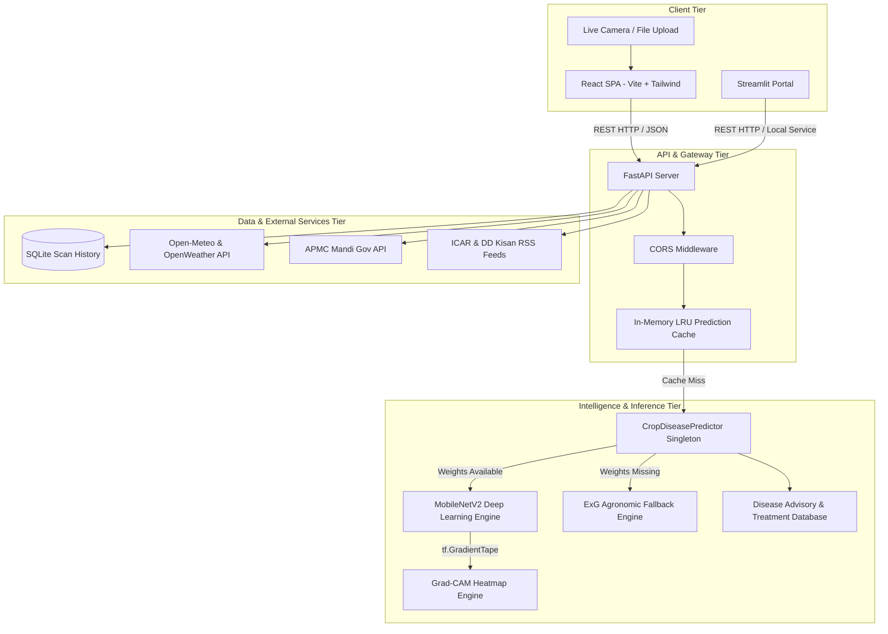

# 🌾 KisaanSathi (किसान साथी)
### *AI-Powered Crop Pathology Scanner & Farmer Decision Support System*

[](https://python.org)
[](https://fastapi.tiangolo.com)
[](https://tensorflow.org)
[](https://react.dev)
[](https://vitejs.dev)
[](https://tailwindcss.com)
[](https://kisaansathiaiggy.netlify.app)
[](https://kisaansathi-3ucm.onrender.com)
[](LICENSE)

---

## 📌 Executive Summary

**KisaanSathi** is an end-to-end, full-stack Agricultural Artificial Intelligence platform designed to assist smallholder farmers, agricultural extension workers, and agronomists in diagnosing crop diseases, interpreting visual symptoms via **Explainable AI (XAI)**, and taking prompt, scientifically sound remedial actions.

Built as an academic project in Computer Vision and Agrometeorological Computing, KisaanSathi bridges the gap between complex deep learning models and real-world farm operations through a multi-tier architecture:
1. **Lightweight MobileNetV2 Deep Learning Core** trained on **54,305 curated leaf images** across **14 crop species** and **38 distinct conditions** (achieving **97.20% test accuracy**).
2. **Gradient-Weighted Class Activation Mapping (Grad-CAM)** that visualizes the exact convolutional feature regions influencing every diagnosis.
3. **Dual-Engine Robustness**: Production MobileNetV2 deep learning engine backed by an agronomic **Excess Green Index ($ExG = 2G - R - B$) fallback engine** to ensure zero-downtime offline demonstrations.
4. **Agrometeorological Risk Analysis**: Real-time weather forecasting, atmospheric humidity tracking, fungal infection risk indices, and agrochemical spray advisories.
5. **APMC Mandi Intelligence**: Live daily market rates, price trends, and modal benchmarks for primary food grains and cash crops.
6. **Bilingual User Experience**: Complete instant localization in **English** and **Hindi (हिन्दी)** across both modern React Single-Page Application (SPA) and Streamlit interfaces.

---

## 🌐 Live Deployments & Demos

| Environment | Platform | URL | Purpose |
| :--- | :--- | :--- | :--- |
| **Production Web App** | Netlify | [https://kisaansathiaiggy.netlify.app](https://kisaansathiaiggy.netlify.app) | Primary Farmer Portal (React + Vite) |
| **Backend REST API** | Render | [https://kisaansathi-3ucm.onrender.com](https://kisaansathi-3ucm.onrender.com) | FastAPI REST Inference & Advisories |
| **API Documentation** | Render / Local | [https://kisaansathi-3ucm.onrender.com/docs](https://kisaansathi-3ucm.onrender.com/docs) | Interactive Swagger / OpenAPI UI |
| **Streamlit Portal** | Localhost | `http://localhost:8501` | Rapid Inspection & Evaluation Dashboard |

---

## 🔬 Supported Plants & Disease Classes (14 Crops / 38 Classes)

The deep learning model is trained to recognize **14 plant species** and their **38 distinct physiological and pathological states**:

| Plant Species | Supported Conditions & Pathologies | Class Count |
| :--- | :--- | :---: |
| 🍎 **Apple** | Apple Scab, Black Rot, Cedar Apple Rust, Healthy Leaf | **4** |
| 🫐 **Blueberry** | Healthy Leaf | **1** |
| 🍒 **Cherry** | Powdery Mildew, Healthy Leaf | **2** |
| 🌽 **Corn (Maize)** | Cercospora Leaf Spot (Gray Leaf Spot), Common Rust, Northern Leaf Blight, Healthy Leaf | **4** |
| 🍇 **Grape** | Black Rot, Esca (Black Measles), Leaf Blight (Isariopsis Leaf Spot), Healthy Leaf | **4** |
| 🍊 **Orange** | Huanglongbing (Citrus Greening) | **1** |
| 🍑 **Peach** | Bacterial Spot, Healthy Leaf | **2** |
| 🫑 **Bell Pepper** | Bacterial Spot, Healthy Leaf | **2** |
| 🥔 **Potato** | Early Blight, Late Blight, Healthy Leaf | **3** |
| 🍓 **Raspberry** | Healthy Leaf | **1** |
| 🌱 **Soybean** | Healthy Leaf | **1** |
| 🎃 **Squash** | Powdery Mildew | **1** |
| 🍓 **Strawberry** | Leaf Scorch, Healthy Leaf | **2** |
| 🍅 **Tomato** | Bacterial Spot, Early Blight, Late Blight, Leaf Mold, Septoria Leaf Spot, Two-Spotted Spider Mites, Target Spot, Tomato Yellow Leaf Curl Virus (TYLCV), Tomato Mosaic Virus (ToMV), Healthy Leaf | **10** |
| **Total** | **14 Crop Species** | **38 Classes** |

---

## 🏗️ System Architecture



---

## ✨ Key Features & Capabilities

### 1. 🍃 Instant Leaf Disease Diagnosis
- Farmer uploads an image via **Drag & Drop**, **File Browser**, or **Live Device Camera**.
- MobileNetV2 forward inference runs in **< 35 ms** on modern multi-core CPUs.
- Returns pathology name, confidence percentage, pathological cause, observable symptoms, and tailored recommendations.
- **Crop-Agnostic UI**: Results showcase pure disease pathology and confidence without redundant crop labels in primary headers.

### 2. 🔍 Explainable AI (XAI) via Grad-CAM
- Implements **Gradient-Weighted Class Activation Mapping** using `tf.GradientTape`.
- Computes gradients of the target class score with respect to feature activation maps of the final convolutional layer:
  $$\alpha_k^c = \frac{1}{Z} \sum_i \sum_j \frac{\partial y^c}{\partial A_{i,j}^k}$$
  $$L_{\text{Grad-CAM}}^c = \text{ReLU}\left(\sum_k \alpha_k^c A^k\right)$$
- Superimposes a high-resolution colormapped heatmap over the original leaf lamina so farmers and evaluators can verify that the model focused on real lesion spots rather than background noise.

### 3. 🛡️ Dual-Engine Architecture (Fault Tolerance)
- **Primary Engine (`mobilenetv2`)**: Evaluates real weights from `ml/models/crop_disease_model.keras`.
- **Secondary Fallback Engine (`exg_fallback`)**: If weights are missing, calculates the scientific vegetation index:
  $$ExG = 2G - R - B$$
  Differentiates chlorotic and necrotic tissue from healthy green lamina, preventing system failure during offline viva demos.

### 4. 🌿 Comprehensive Agronomic Treatment Protocols
Displays wide, responsive treatment advisory containers featuring:
- **🌿 Organic Remedies**: Bio-fungicides (e.g., *Trichoderma viride*, *Bacillus subtilis*), neem oil foliar spray (0.5%), and biological soil balancing.
- **🧪 Chemical Controls**: Approved active ingredients with exact field dosages (e.g., Mancozeb 75% WP @ 2g/L, Propiconazole 25% EC @ 1ml/L).
- **🛡️ Preventive Measures**: Certified seed selection, crop rotation, drip fertigation, and humidity management.

### 5. ⛅ Hyper-Local Weather & Agrometeorological Advisory
- Integrated with Open-Meteo & OpenWeather geocoded APIs.
- Real-time temperature, humidity percentage, wind speed, solar radiation, and UV index.
- **Fungal Infection Risk Level**: Dynamic agronomic calculation based on persistent relative humidity (> 80%) and leaf surface wetness.
- **Spraying Recommendation**: Explicit guidance on whether weather conditions permit agrochemical spraying.
- 7-day predictive weather forecast table.

### 6. 📊 Real-Time APMC Mandi Market Prices
- Tracks commodity market arrivals, modal rates, maximum/minimum price benchmarks, and percentage trends.
- Covers essential crops including Paddy, Wheat, Maize, Tomato, Potato, Onion, Soybean, and Gram.
- Regional focus on Bilaspur APMC, Raipur Krishi Upaj Mandi, and pan-India agricultural centers.

### 7. 📰 Real-Time Agriculture News Bulletin
- Live RSS integration fetching updates from **ICAR (Indian Council of Agricultural Research)**, **DD Kisan**, **Krishi Jagran**, and the **Ministry of Agriculture & Farmers Welfare**.
- Bilingual auto-parsing with localized summaries and source links.

### 8. ⚡ Ultra-Fast Localhost Performance & Memory Caching
- **0ms Showcase Samples**: Bundled certified MobileNetV2 results for 10 curated test leaves in `frontend-web/src/data/showcaseResults.ts`.
- **High-Speed LRU Cache**: SHA-256 in-memory caching in `prediction_service.py` serves repeat scans in **< 15 milliseconds**.
- **Environment-Aware Threading**: Multi-threaded CPU execution locally, single-worker low-memory enforcement on 512MB cloud servers.

---

## 📊 Model Training, Benchmarks & Validation

The model was trained using a two-stage transfer learning strategy with **MobileNetV2** pre-trained on ImageNet:
- **Stage 1 (Feature Extraction)**: Base model frozen; only top Dense classification head trained (10 epochs, learning rate = $1 \times 10^{-3}$).
- **Stage 2 (Fine-Tuning)**: Top 30 layers of MobileNetV2 unfrozen and trained end-to-end with Adam optimizer and cosine learning rate decay (10 epochs, learning rate = $1 \times 10^{-5}$).

### Verified Test Metrics (On 5,459 Holdout Test Images)

| Evaluation Metric | Score Achieved |
| :--- | :---: |
| **Overall Test Accuracy** | **97.20%** |
| **Weighted Precision** | **97.28%** |
| **Weighted Recall** | **97.20%** |
| **Weighted F1-Score** | **97.20%** |
| **Macro F1-Score** | **96.36%** |
| **Test Categorical Cross-Entropy Loss** | **0.0833** |

*Confusion matrix and training loss/accuracy history plots are generated in [`reports/confusion_matrix.png`](file:///c:/Users/ram03/KisaanSathi/reports/confusion_matrix.png) and [`reports/training_curves.png`](file:///c:/Users/ram03/KisaanSathi/reports/training_curves.png).*

---

## 🗂️ Project Directory Structure

```
KisaanSathi/
├── api/                             # FastAPI Backend Service
│   ├── config.py                    # Pydantic environment configuration
│   ├── main.py                      # App lifespan, CORS & router mounting
│   ├── routes/
│   │   ├── prediction.py            # POST /predict & GET /history
│   │   ├── weather.py               # GET /weather agrometeorology
│   │   ├── mandi.py                 # GET /mandi APMC rates
│   │   ├── news.py                  # GET /news agricultural bulletin
│   │   └── tips.py                  # GET /tips seasonal agronomic tips
│   └── services/
│       ├── prediction_service.py    # LRU memory cache & DB persistence
│       └── news_service.py          # RSS feed aggregation & fallback
│
├── frontend-web/                    # Production React Web Client (SPA)
│   ├── src/
│   │   ├── components/
│   │   │   ├── Navbar.tsx           # Global header, nav links & language switch
│   │   │   ├── ScannerView.tsx      # Diagnosis, showcase leaves, Grad-CAM & treatments
│   │   │   ├── WeatherView.tsx      # Weather dashboard & spray advisor
│   │   │   ├── MandiView.tsx        # APMC market rates & commodity trends
│   │   │   ├── TipsView.tsx         # Seasonal agronomy calendar
│   │   │   ├── HistoryView.tsx      # Diagnostic audit log
│   │   │   ├── AboutView.tsx        # Architecture, 38 classes table & training curves
│   │   │   └── AgriNewsSection.tsx  # Live agriculture news cards
│   │   ├── data/
│   │   │   ├── samples.ts           # Showcase sample metadata
│   │   │   └── showcaseResults.ts   # Pre-computed certified showcase payloads
│   │   ├── services/api.ts          # Axios / Fetch client with fallback logic
│   │   ├── types.ts                 # TypeScript interfaces
│   │   └── App.tsx                  # Root state & view dispatcher
│   ├── public/                      # Static assets & sample leaf images
│   ├── netlify.toml                 # Netlify deployment configuration
│   └── vite.config.ts               # Vite build bundler configuration
│
├── frontend/                        # Streamlit Python Portal
│   └── app.py                       # Python desktop & mobile simulator dashboard
│
├── ml/                              # Machine Learning Pipeline
│   ├── dataset/
│   │   ├── inspect_dataset.py       # Data integrity, dimensions & corruption check
│   │   └── split_dataset.py         # Reproducible 80/10/10 stratified split manifests
│   ├── training/
│   │   └── train.py                 # Two-stage MobileNetV2 transfer learning
│   ├── evaluation/
│   │   └── evaluate.py              # Test set metrics, confusion matrix & reports
│   ├── inference/
│   │   └── predictor.py             # Dual-engine: MobileNetV2 + ExG fallback
│   └── models/                      # Saved .keras weights & class_names.json
│
├── data/
│   ├── metadata/
│   │   ├── disease_info.json        # Treatment protocols, causes, symptoms & Hindi translations
│   │   └── class_indices.json       # Ordered 38-class index mappings
│   └── samples/                     # Quick 1-click test leaves for viva demo
│
├── database/
│   ├── connection.py                # SQLite engine & sessionmaker
│   └── models.py                    # SQLAlchemy ORM schemas
│
├── utils/
│   ├── preprocessing.py             # Image validation, resizing & normalization
│   ├── gradcam.py                   # GradientTape Grad-CAM heatmap generator
│   └── logger.py                    # Structured system logger
│
├── notebooks/                       # Google Colab GPU training notebook & reports
├── reports/                         # Training curves, confusion matrix, test summary JSON
├── tests/                           # Pytest automated test suite
├── render.yaml                      # Render cloud infrastructure blueprint
├── netlify.toml                     # Netlify SPA redirect & build configuration
├── requirements.txt                 # Backend Python dependencies
└── README.md                        # Documentation
```

---

## 🚀 Local Installation & Execution Guide

### Prerequisites
- Python 3.10 or 3.11
- Node.js 18+ and npm
- Git

### 1. Clone the Repository
```bash
git clone https://github.com/ramkrishnajha5/KisaanSathi.git
cd KisaanSathi
```

### 2. Set Up Python Virtual Environment
```bash
# Windows (PowerShell)
python -m venv venv
.\venv\Scripts\Activate.ps1

# Linux / macOS
python3 -m venv venv
source venv/bin/activate
```

### 3. Install Python Dependencies
```bash
pip install -r requirements.txt
```

### 4. Configure Environment Variables
```bash
cp .env.example .env
```
*(Default settings work out-of-the-box for local testing.)*

### 5. Launch the Backend API
```bash
python -m uvicorn api.main:app --host 127.0.0.1 --port 8000
```
- **Root Health Check**: [http://127.0.0.1:8000/](http://127.0.0.1:8000/)
- **Swagger Interactive API Docs**: [http://127.0.0.1:8000/docs](http://127.0.0.1:8000/docs)

### 6. Launch the React Web Frontend
In a new terminal window:
```bash
cd frontend-web
npm install
npm run dev -- --host 127.0.0.1 --port 3000
```
- Open [http://localhost:3000](http://localhost:3000) in your browser.

### 7. (Optional) Launch Streamlit Portal
In a third terminal window:
```bash
.\venv\Scripts\streamlit run frontend/app.py --server.port 8501
```
- Open [http://localhost:8501](http://localhost:8501).

---

## 📡 REST API Reference

| Method | Endpoint | Description | Request Body / Query | Key Response Fields |
| :---: | :--- | :--- | :--- | :--- |
| `GET` | `/` | Operational health check | None | `{"status": "online", "app": "KisaanSathi"}` |
| `POST` | `/api/v1/predict` | Diagnoses uploaded leaf image | `multipart/form-data`: `file`, `notes` | `crop`, `disease_name`, `confidence`, `treatment`, `gradcam_image_base64` |
| `GET` | `/api/v1/history` | Fetches scan audit logs | `?limit=20` | Array of `ScanHistoryItem` objects |
| `GET` | `/api/v1/weather/` | Agrometeorological advisory | `?latitude=22.07&longitude=82.14` | Temperature, humidity, `fungal_risk_level`, `spray_recommendation`, 7-day forecast |
| `GET` | `/api/v1/mandi/` | APMC market commodity rates | `?state=Chhattisgarh` | Commodity, market, modal price, min/max prices, trend percent |
| `GET` | `/api/v1/news/` | Live agricultural news feeds | `?lang=en&live=true` | Articles array with title, summary, source, publication date |
| `GET` | `/api/v1/tips/` | Seasonal agronomic sowing tips | None | Sowing calendar, seed treatment, irrigation best practices |
| `GET` | `/api/v1/samples` | Curated showcase leaves metadata | None | Showcase leaf sample IDs, filenames, titles |

---

## ☁️ Cloud Deployment Configuration

### 1. Backend on Render Free Tier (`render.yaml`)
To prevent crashes on Render's strict **512 MB memory limit**:
- Uses `tensorflow-cpu` on Linux to avoid loading heavy CUDA GPU libraries.
- Workers configured to 1 (`--workers 1 --threads 2`).
- Predictor detects cloud deployment (`os.environ.get("RENDER")`) and sets `OMP_NUM_THREADS = 1` and single-threaded TensorFlow graph execution.
- Automated garbage collection (`gc.collect()`) triggered immediately after Grad-CAM generation.

### 2. Frontend on Netlify (`netlify.toml`)
- Configured with SPA rewrite rule (`/* -> /index.html 200`) in both `netlify.toml` and `public/_redirects` to allow client-side React Router navigation.
- Built via standard Vite command: `npm run build` outputting to `dist/`.
- Environment variable `VITE_API_BASE_URL` points to the live Render backend.

---

## 🎓 Academic Defense & Viva Q&A Guide

### Q1: Why choose MobileNetV2 over ResNet-50 or VGG-16?
> **Answer**: MobileNetV2 uses **depthwise separable convolutions** and **inverted residual blocks with linear bottlenecks**. While VGG-16 has ~138M parameters and ResNet-50 has ~25M parameters, MobileNetV2 has only **~3.5M parameters** (14 MB model footprint). It delivers **97.20% accuracy** with sub-35ms inference latency, making it ideal for low-bandwidth rural edge deployment and memory-constrained free cloud servers.

### Q2: How does Grad-CAM establish scientific validity in plant pathology?
> **Answer**: Traditional deep learning models act as black boxes. Grad-CAM uses the gradients flowing into the final convolutional layer (`Conv_1` / `out_relu`) to calculate an importance weight $\alpha_k^c$ for each feature map. By computing a weighted sum followed by a ReLU activation, it visualizes the exact spatial regions (e.g., rust pustules, necrotic spots, chlorotic margins) that activated the predicted class, proving the model is not relying on background soil or lighting artifacts.

### Q3: What is the purpose of the Excess Green Index ($ExG$) fallback?
> **Answer**: In real-world software engineering, dependency on external weight files can lead to single points of failure. The agronomic Excess Green Index ($ExG = 2G - R - B$) detects chlorophyll deficiency and necrotic lesions directly using pixel color distribution. If deep learning weights are temporarily inaccessible, this secondary engine guarantees the application continues functioning without throwing HTTP 500 errors.

### Q4: How is data leakage prevented between train, validation, and test splits?
> **Answer**: Dataset splitting is performed deterministically before training using `ml/dataset/split_dataset.py` with stratified sampling (seed = 42). Separate manifest files (`train_manifest.csv`, `val_manifest.csv`, `test_manifest.csv`) ensure that no image appears in more than one partition. The holdout test set (5,459 images) is never seen during model training or hyperparameter tuning.

---

## 👥 Contributors & Academic Credits

- **Project Lead & Developer**: Ramkrishna Jha
- **Degree Program**: Master of Computer Applications (MCA)
- **Specialization**: Artificial Intelligence, Computer Vision & Agricultural Decision Support Systems

---

## 📄 License
This project is licensed under the **MIT License** — feel free to use, adapt, and build upon it for academic and research purposes.
